# Acconeer ERP — User Flow & Interface Specification

**Target System:** `acconeer.zestwings.com`  
**Generated:** 2026-11-17T17:42:45.690Z  
**Documented Flows:** 54 Screens  

Comprehensive visual guide for ERP workflows, ledger reconciliations, and compliance validation.

---

## Module: Dashboard

### 01 Executive Dashboard
- **Purpose:** Executive KPI cards, quick actions, and revenue/expense liquidity snapshot.
- **Local File:** `./Dashboard/01_Executive_Dashboard.png`

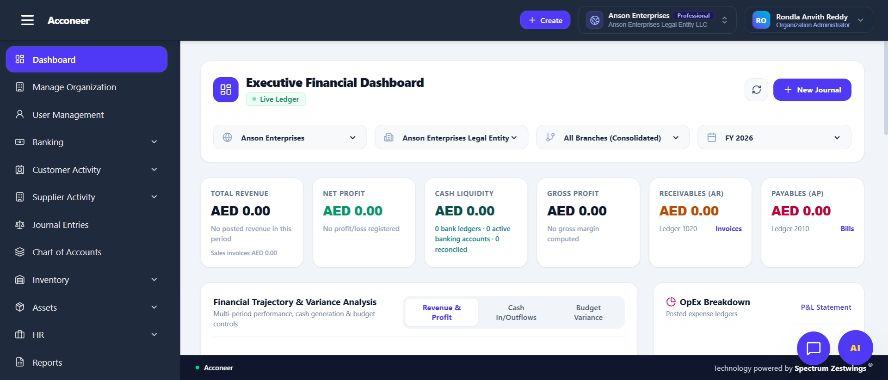

---

## Module: Banking

### 01 Banking Overview
- **Purpose:** Bank accounts directory, balances, and cash-in-transit metrics.
- **Local File:** `./Banking/01_Banking_Overview.png`

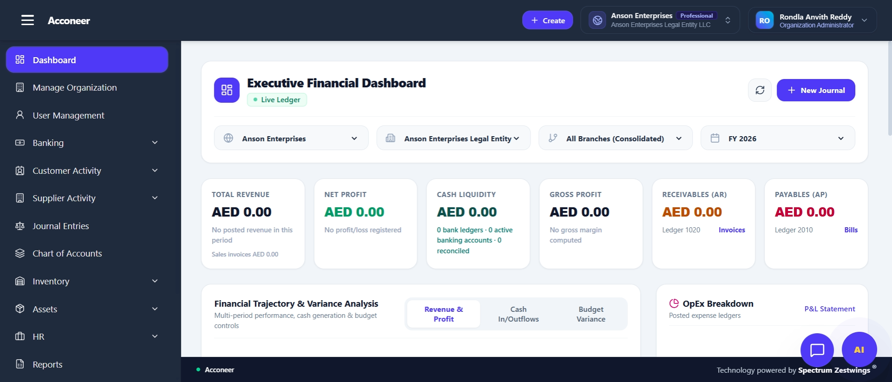

---

### 02 Bank Accounts
- **Purpose:** Detailed accounts register with currency and IBAN ledgers.
- **Local File:** `./Banking/02_Bank_Accounts.png`

---

### 03 Bank Reconciliation
- **Purpose:** Statement matching, clearance state, and discrepancy reconciler.
- **Local File:** `./Banking/03_Bank_Reconciliation.png`

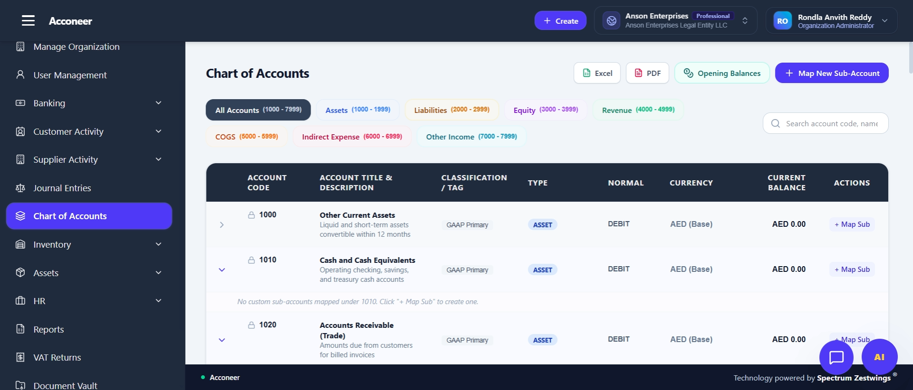

---

## Module: Customer Activity

### 01 Customer Directory
- **Purpose:** Customer database, credit limits, and contact profiles.
- **Local File:** `./Customer_Activity/01_Customer_Directory.png`

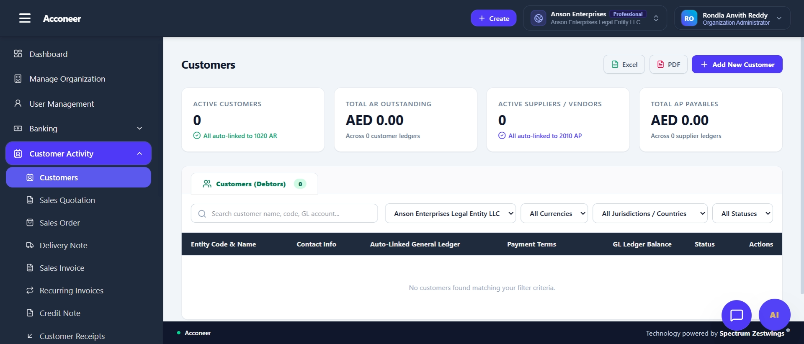

---

### 02 Sales Quotation
- **Purpose:** Estimate creation, discount matrices, and proposal lifecycle.
- **Local File:** `./Customer_Activity/02_Sales_Quotation.png`

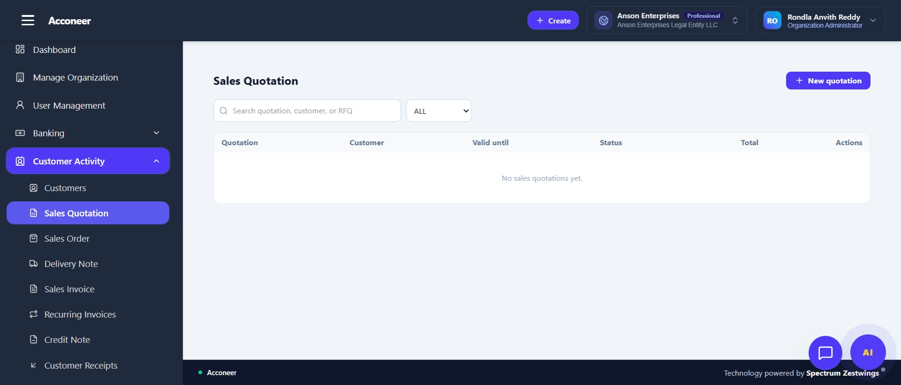

---

### 03 Sales Order
- **Purpose:** Confirmed customer purchase orders and reservation checks.
- **Local File:** `./Customer_Activity/03_Sales_Order.png`

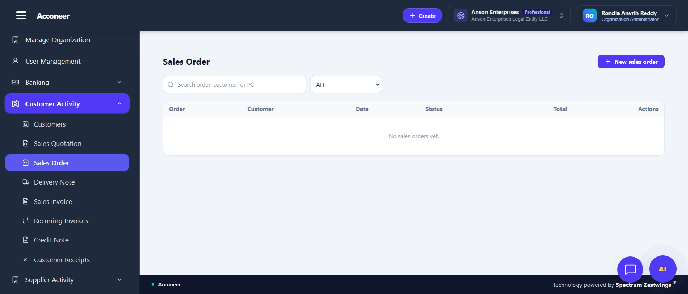

---

### 04 Delivery Note
- **Purpose:** Dispatch documentation and stock deduction verification.
- **Local File:** `./Customer_Activity/04_Delivery_Note.png`

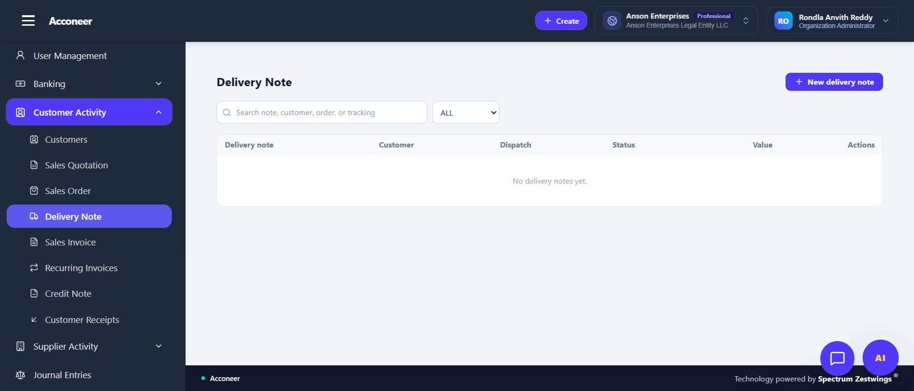

---

### 05 Sales Invoice
- **Purpose:** Tax invoices with UAE VAT (5%) calculation and receivables ledger.
- **Local File:** `./Customer_Activity/05_Sales_Invoice.png`

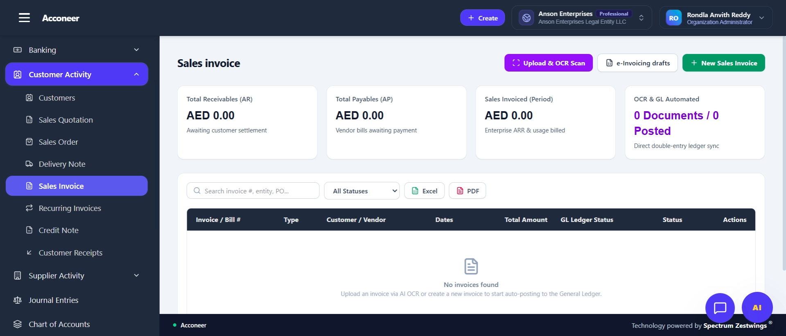

---

### 06 Recurring Invoices
- **Purpose:** Subscription and automated recurring billing schedules.
- **Local File:** `./Customer_Activity/06_Recurring_Invoices.png`

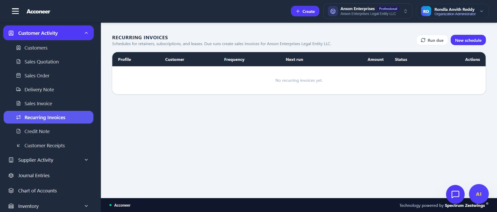

---

### 07 Credit Note
- **Purpose:** Customer refunds, sales returns, and VAT Box 8 adjustments.
- **Local File:** `./Customer_Activity/07_Credit_Note.png`

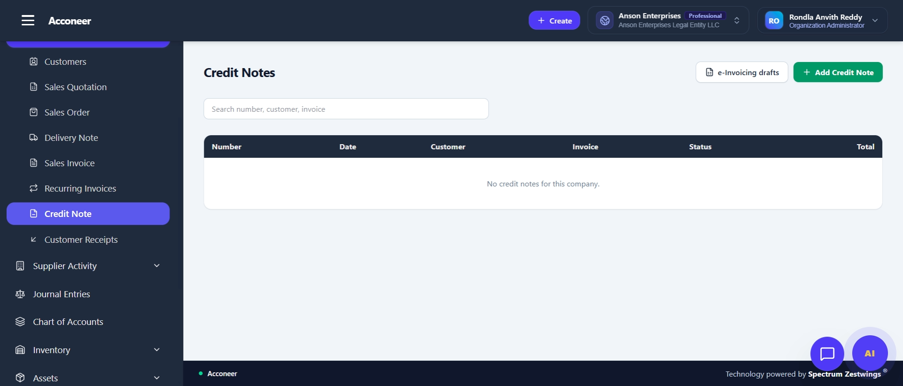

---

### 08 Customer Receipts
- **Purpose:** Payment receipt processing and invoice matching.
- **Local File:** `./Customer_Activity/08_Customer_Receipts.png`

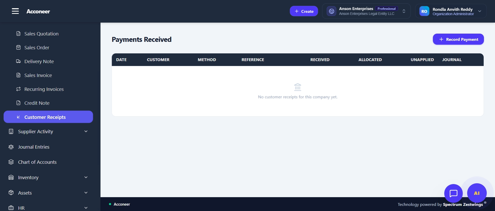

---

## Module: Supplier Activity

### 01 Vendor Directory
- **Purpose:** Supplier master registry, payment terms, and TRN data.
- **Local File:** `./Supplier_Activity/01_Vendor_Directory.png`

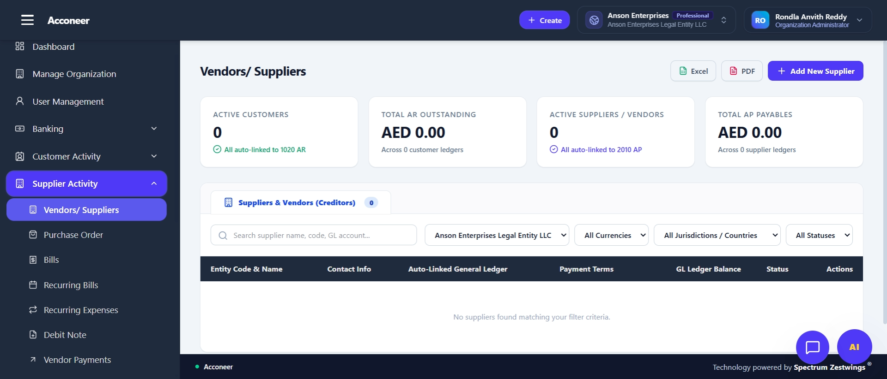

---

### 02 Purchase Order
- **Purpose:** Supplier purchase requests, authorization workflows, and terms.
- **Local File:** `./Supplier_Activity/02_Purchase_Order.png`

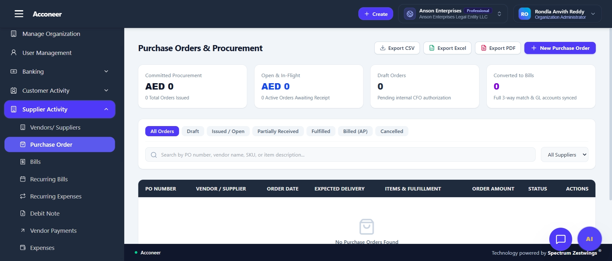

---

### 03 Bills
- **Purpose:** Supplier invoice capture and Accounts Payable scheduling.
- **Local File:** `./Supplier_Activity/03_Bills.png`

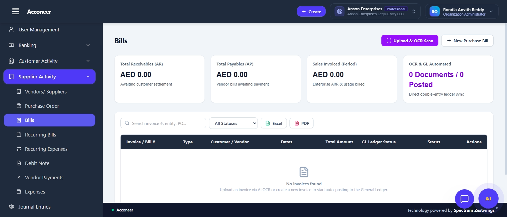

---

### 04 Recurring Bills
- **Purpose:** Fixed contractual supplier billing schedules.
- **Local File:** `./Supplier_Activity/04_Recurring_Bills.png`

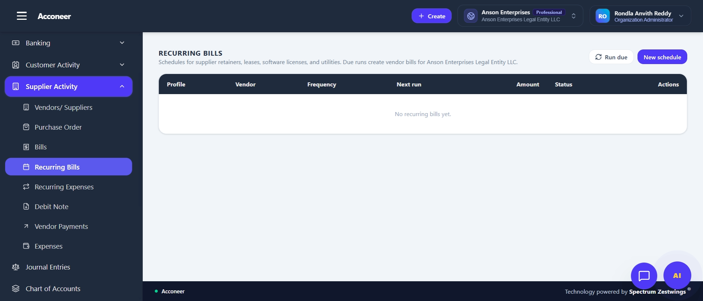

---

### 05 Recurring Expenses
- **Purpose:** Automated recurring operational expenditures.
- **Local File:** `./Supplier_Activity/05_Recurring_Expenses.png`

---

### 06 Debit Note
- **Purpose:** Purchase returns and supplier credit balance claims.
- **Local File:** `./Supplier_Activity/06_Debit_Note.png`

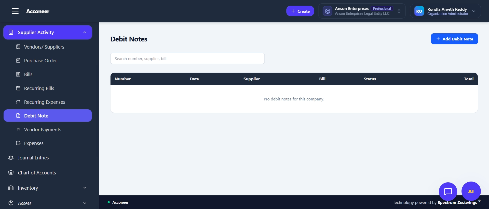

---

### 07 Vendor Payments
- **Purpose:** Disbursements, check registers, and wire settlements.
- **Local File:** `./Supplier_Activity/07_Vendor_Payments.png`

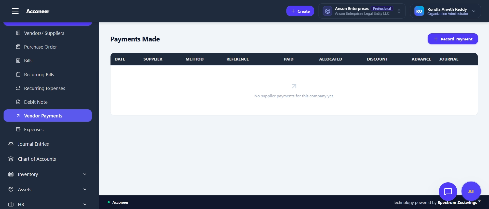

---

### 08 Expenses
- **Purpose:** Out-of-pocket operational and petty cash expense tracking.
- **Local File:** `./Supplier_Activity/08_Expenses.png`

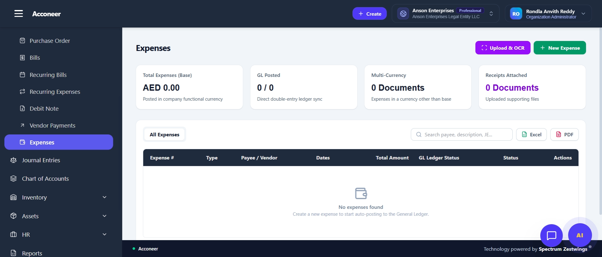

---

## Module: General Ledger

### 01 Journal Entries
- **Purpose:** Manual GL vouchers, journal search, and ledger adjustments.
- **Local File:** `./General_Ledger/01_Journal_Entries.png`

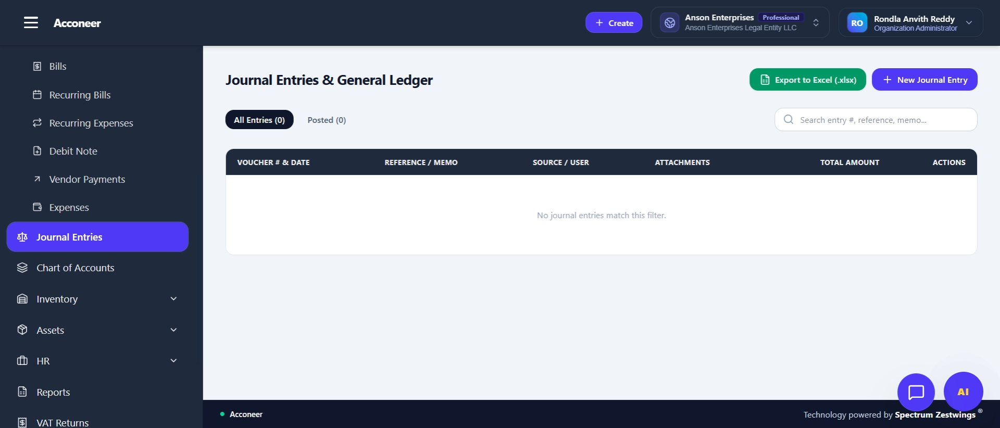

---

## Module: Chart of Accounts

### 01 Accounts Tree
- **Purpose:** Multi-level CoA hierarchy, account codes, debit/credit types, and sub-account mappings.
- **Local File:** `./Chart_of_Accounts/01_Accounts_Tree.png`

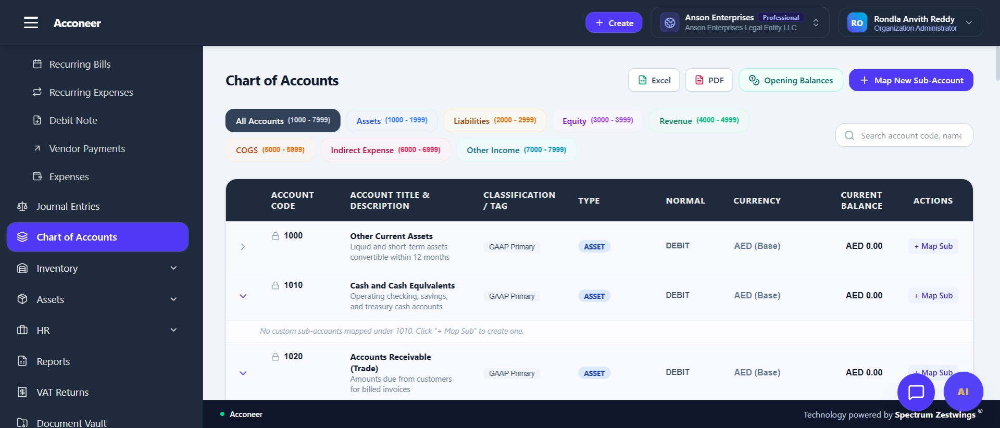

---

## Module: Inventory

### 01 Inventory Master
- **Purpose:** Inventory master overview and stock valuation summary.
- **Local File:** `./Inventory/01_Inventory_Master.png`

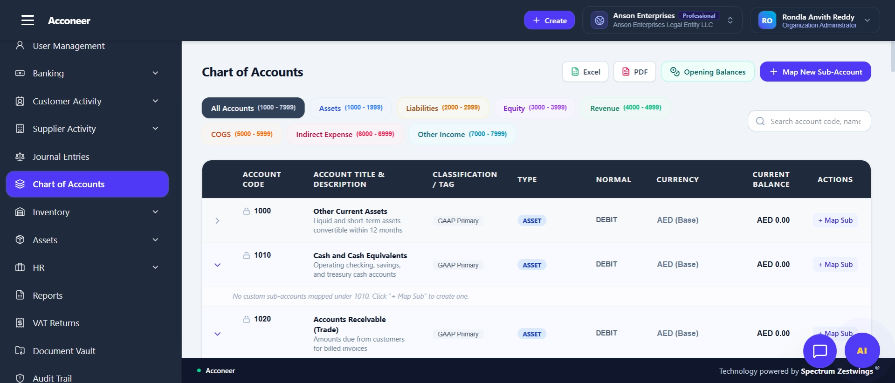

---

### 02 Add Category
- **Purpose:** Product family categorization and GL linkage.
- **Local File:** `./Inventory/02_Add_Category.png`

---

### 03 Add Sub Category
- **Purpose:** Granular stock classification and attributes.
- **Local File:** `./Inventory/03_Add_Sub_Category.png`

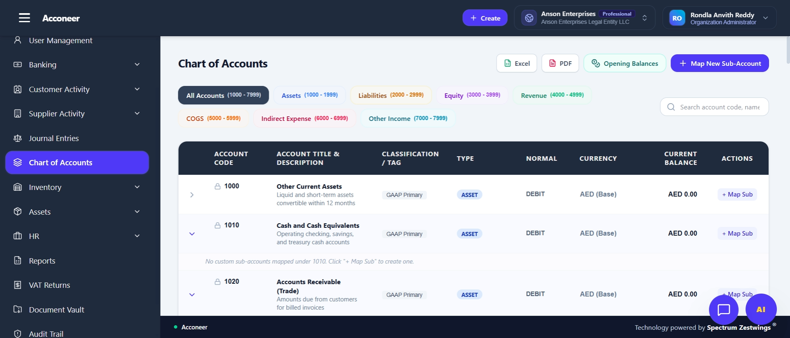

---

### 04 Attribute Criterion
- **Purpose:** Product variation dimensions (Size, Grade, Color).
- **Local File:** `./Inventory/04_Attribute_Criterion.png`

---

### 05 Attribute Value
- **Purpose:** Assigned attribute variants.
- **Local File:** `./Inventory/05_Attribute_Value.png`

---

### 06 Units of Measurement
- **Purpose:** Standard conversion rates (PCS, KG, BOX, PALLET).
- **Local File:** `./Inventory/06_Units_of_Measurement.png`

---

### 07 Add SKU
- **Purpose:** Stock keeping unit master creation and barcoding.
- **Local File:** `./Inventory/07_Add_SKU.png`

---

### 08 Map Catalogue Code
- **Purpose:** Supplier catalog and OEM cross-referencing.
- **Local File:** `./Inventory/08_Map_Catalogue_Code.png`

---

### 09 Manage Warehouse
- **Purpose:** Multi-branch warehouse locations and bin management.
- **Local File:** `./Inventory/09_Manage_Warehouse.png`

---

### 10 Rejection Reason
- **Purpose:** QA receiving rejection audit codes.
- **Local File:** `./Inventory/10_Rejection_Reason.png`

---

### 11 Goods Received Note
- **Purpose:** Physical inventory receiving and quality gate validation.
- **Local File:** `./Inventory/11_Goods_Received_Note.png`

---

## Module: Assets

### 01 Asset Master
- **Purpose:** Fixed asset portfolio, net book values, and depreciation schedules.
- **Local File:** `./Assets/01_Asset_Master.png`

---

### 02 Asset Category
- **Purpose:** Depreciation classes (Equipment, IT, Furniture, Vehicles).
- **Local File:** `./Assets/02_Asset_Category.png`

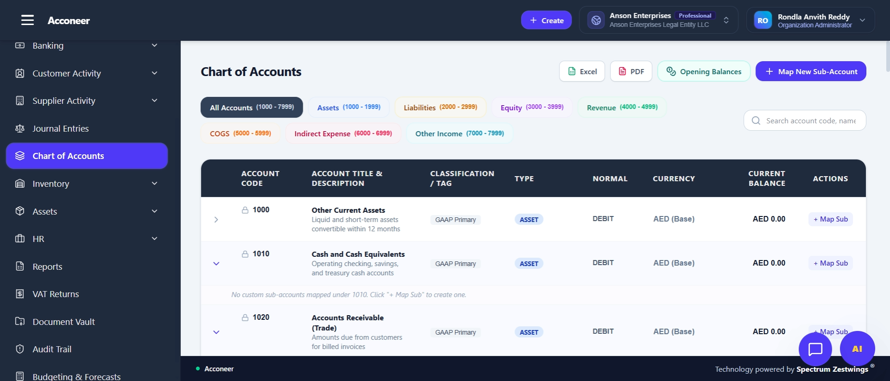

---

### 03 Asset Sub Category
- **Purpose:** Secondary fixed asset classifications.
- **Local File:** `./Assets/03_Asset_Sub_Category.png`

---

### 04 Asset Identifier
- **Purpose:** Serial tagging and barcoding schemes.
- **Local File:** `./Assets/04_Asset_Identifier.png`

---

### 05 Asset Identifier Value
- **Purpose:** Asset tag assignment records.
- **Local File:** `./Assets/05_Asset_Identifier_Value.png`

---

### 06 Asset Register
- **Purpose:** Comprehensive asset ledger with capitalized dates and salvage values.
- **Local File:** `./Assets/06_Asset_Register.png`

---

## Module: Human Resources

### 01 HR Overview
- **Purpose:** Human capital management dashboard and active headcount.
- **Local File:** `./Human_Resources/01_HR_Overview.png`

---

### 02 Employee Directory
- **Purpose:** Staff profiles, labour contracts, and designation mapping.
- **Local File:** `./Human_Resources/02_Employee_Directory.png`

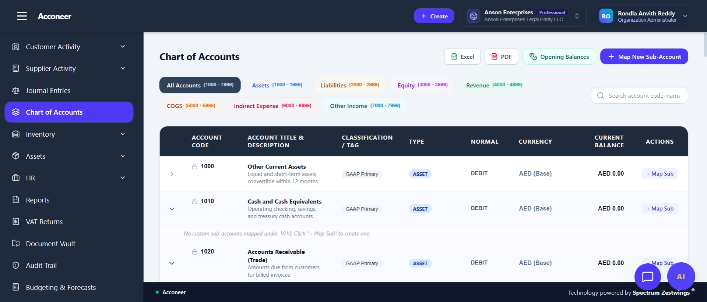

---

### 03 Set Calendar
- **Purpose:** Shift rosters, public holidays, and weekend structures.
- **Local File:** `./Human_Resources/03_Set_Calendar.png`

---

### 04 Attendance
- **Purpose:** Biometric and clock-in operational logs.
- **Local File:** `./Human_Resources/04_Attendance.png`

---

### 05 Daily Timesheet
- **Purpose:** Billable hour allocations and project timesheets.
- **Local File:** `./Human_Resources/05_Daily_Timesheet.png`

---

### 06 Document Repository
- **Purpose:** Visa, Emirates ID, and labor card records.
- **Local File:** `./Human_Resources/06_Document_Repository.png`

---

### 07 Payroll
- **Purpose:** Salary calculation, allowances, deductions, and WPS files.
- **Local File:** `./Human_Resources/07_Payroll.png`

---

### 08 Manage Leaves
- **Purpose:** Annual, sick, and unpaid leave requests and balances.
- **Local File:** `./Human_Resources/08_Manage_Leaves.png`

---

### 09 Performance
- **Purpose:** Appraisal cycles, employee scoring, and reviews.
- **Local File:** `./Human_Resources/09_Performance.png`

---

## Module: Reports

### 01 Financial Reports
- **Purpose:** Trial Balance, P&L, and Balance Sheet with period comparison.
- **Local File:** `./Reports/01_Financial_Reports.png`

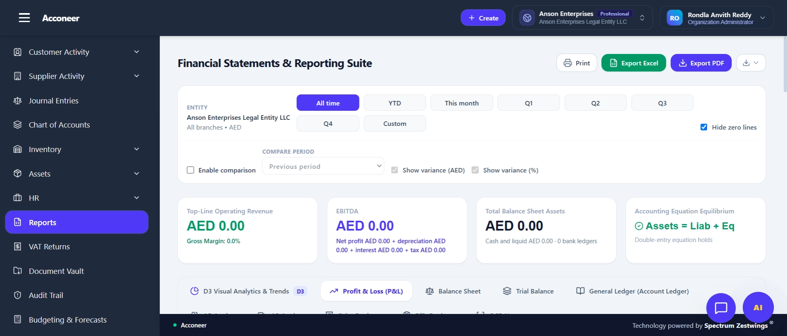

---

## Module: VAT Returns

### 01 VAT Filing Dashboard
- **Purpose:** UAE FTA 201 returns with Box 8 (Output), Box 11 (Input), and Box 14 (Net Due).
- **Local File:** `./VAT_Returns/01_VAT_Filing_Dashboard.png`

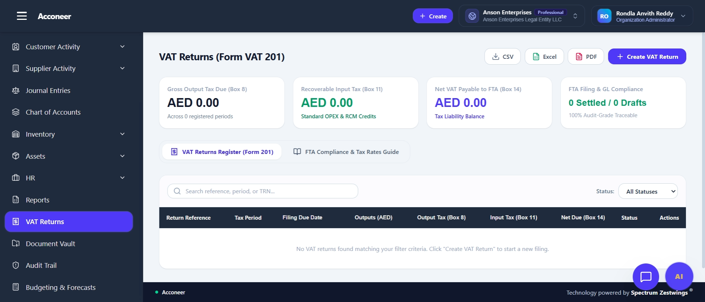

---

## Module: Document Vault

### 01 Vault Registry
- **Purpose:** Trade licenses, tax certs, bank mandates, and regulatory renewals.
- **Local File:** `./Document_Vault/01_Vault_Registry.png`

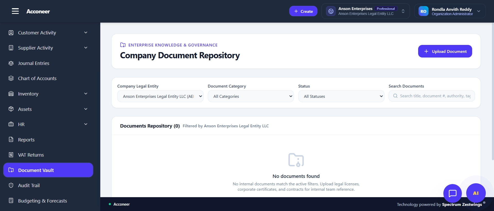

---

## Module: Audit Trail

### 01 Security Audit Logs
- **Purpose:** Forensic log of GL postings, data migrations, logins, and system changes.
- **Local File:** `./Audit_Trail/01_Security_Audit_Logs.png`

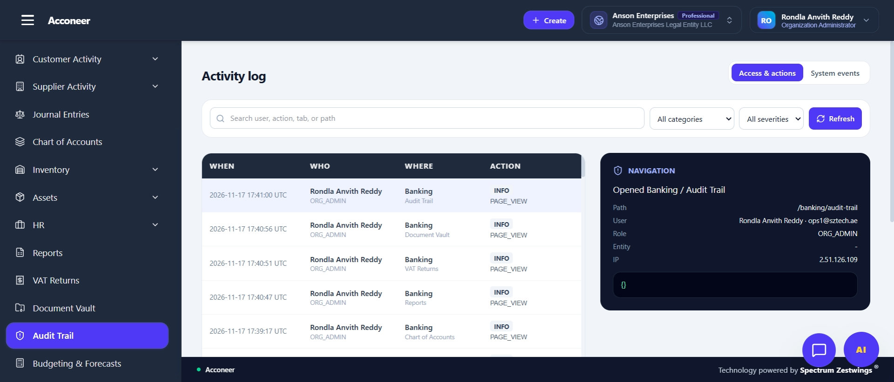

---

## Module: Budgeting

### 01 Budgeting Matrix
- **Purpose:** Fiscal planning, projected allocations, and ledger variance tracking.
- **Local File:** `./Budgeting/01_Budgeting_Matrix.png`

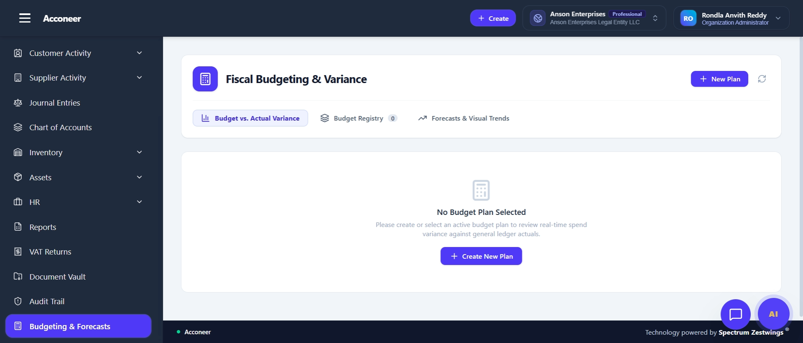

---

## Module: AI Assistant

### 01 Spectrum Zestwings AI
- **Purpose:** Natural language financial intelligence and reporting copilot.
- **Local File:** `./AI_Assistant/01_Spectrum_Zestwings_AI.png`

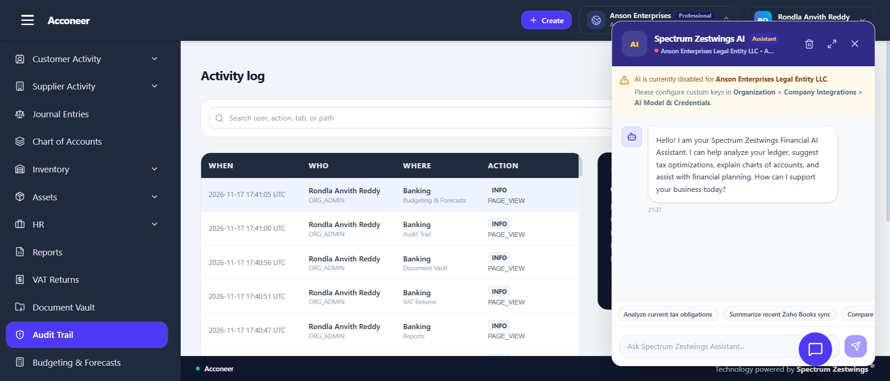

---

